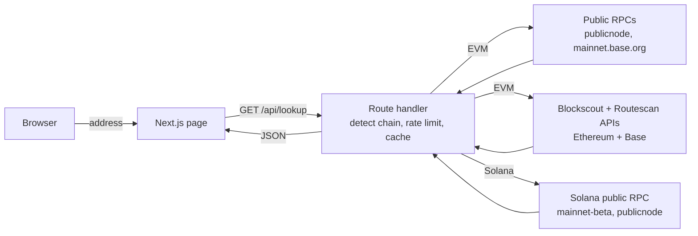

# Wallet Explorer

A read-only multichain wallet explorer. Paste a public address and the app detects the chain automatically. It then shows the native balance, recent transactions with explorer links, tokens and NFTs.

**Live demo:** https://wallet-explorer-ten.vercel.app

- **EVM addresses** (`0x…`) are looked up on **Ethereum mainnet** and **Base**.
- **Solana addresses** (base58) are looked up on **Solana mainnet**.
- No wallet connection, no signing, no API keys. Only free, keyless public endpoints.

## Features

- Automatic chain detection (EVM hex vs. Solana base58 decoded to a 32-byte public key)
- Native balance (ETH on Ethereum and Base, SOL on Solana)
- Last 10 transactions, each linked to Etherscan, Basescan or Solscan
- ERC-20 tokens and NFTs (ERC-721 / ERC-1155 with images) on Ethereum and Base
- SPL / Token-2022 balances on Solana, plus "possible NFTs" (amount 1, 0 decimals)
- One-click example addresses
- Server-side fetching with a short in-memory cache, CDN caching (`s-maxage=60`), timeouts, a retry on 429/5xx, fallback RPCs, and a simple per-IP rate limit
- Each section fails on its own: if one source is down, the rest of the page still renders with a clear "unavailable" message

## Architecture

## Data sources (all free, no key)

| Chain | Balance | Transactions | Tokens | NFTs |
|---|---|---|---|---|
| Ethereum | JSON-RPC `eth_getBalance` (publicnode, LlamaRPC fallback) | Blockscout `eth.blockscout.com` | Routescan (Blockscout fallback) | Blockscout |
| Base | JSON-RPC (`mainnet.base.org`, publicnode fallback) | Blockscout `base.blockscout.com` (see limits) | Blockscout (see limits) | Blockscout (see limits) |
| Solana | `getBalance` (mainnet-beta, publicnode fallback) | `getSignaturesForAddress` | `getTokenAccountsByOwner` | Token accounts with amount 1 and 0 decimals |

## Limits

- **Base: only the balance is reliable right now.** Transactions, tokens and NFTs come from the public Base Blockscout API. At the time of writing it answers HTTP 403 to requests from Vercel's servers, so those sections show "unavailable" with a link to Basescan. No other free keyless source lists Base transactions; Etherscan-style APIs need a key.
- **Ethereum tokens come from Routescan, with Blockscout as the fallback.** Large wallets (like the vitalik.eth example) hold many spam tokens, so the list isn't filtered for value.
- **Public endpoints are rate-limited and best-effort.** Under load, a section may show "unavailable". Results are cached for about 60 seconds.
- **Solana token names and NFT metadata are not shown.** Keyless RPCs don't return them; that needs a paid indexer (for example the DAS API). Mint addresses are shown and linked to Solscan instead, and "possible NFTs" is a heuristic.
- **Only the newest 10 transactions are shown.** EVM transactions are top-level transactions only, without internal transfers.
- **The rate limit is per serverless instance.** It's a basic safeguard, not a global quota.
- **ENS / SNS names aren't resolved.** Paste the raw address.

## Tech stack

- [Next.js](https://nextjs.org) (App Router) + TypeScript
- [Tailwind CSS](https://tailwindcss.com)
- No web3 SDK: plain `fetch` to JSON-RPC and REST endpoints, with BigInt formatting
- Unit tests with the Node test runner (`tsx --test`)
- GitHub Actions CI (type check, tests, build) with no secrets
- Deployed on [Vercel](https://vercel.com) (deploys on every push to `main`)

## Running it yourself

Requires Node.js 20.9+. Run `npm install` and `npm run dev`. Run `npm test` for the unit tests. No environment variables are needed.

## License

[MIT](LICENSE)
